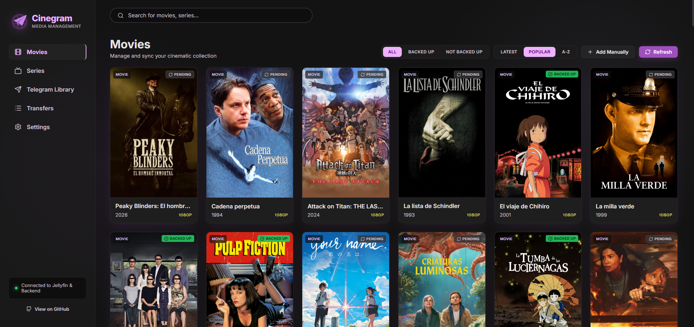

# Cinegram

Cinegram is a self-hosted platform that bridges a [Jellyfin](https://jellyfin.org/) media library with [Telegram](https://telegram.org/). It automates downloading movies and series from Telegram, processes and renames them to Jellyfin's naming convention, and can also back up existing Jellyfin files to Telegram.



It ships as a single container, so a full deployment is one `docker compose up`.

## Key Features

- **Bidirectional Media Transfer**: Download files from Telegram directly into your Jellyfin library, or back up existing Jellyfin media to Telegram.
- **Downloads Folder Import**: Watches a folder for new video files, identifies each one against TMDB and — once you confirm the guess from Telegram or the web — renames and moves it into the library. See [Importing from the downloads folder](#importing-from-the-downloads-folder).
- **Automatic Large File Handling**: Circumvents Telegram's 2 GB bot upload limit by splitting larger files into 1.95 GB multi-part archives using store-only `7z` compression, rejoining them automatically on download.
- **Metadata & Naming Standardization**: Integrates with TMDB to fetch metadata, posters, and standardize filenames/folder structures for Jellyfin.
- **Local Metadata for Non-Official Content**: Flag a season whose numbering doesn't match any online provider and Cinegram writes `.nfo` sidecars next to the files, so Jellyfin reads titles and plots from disk instead of reconciling them against an unrelated online entry. See [Local metadata](#local-metadata-for-non-official-content).
- **Multi-User Access Control**: Restricts bot commands and storage privileges to authorized Telegram user IDs.
- **Web UI & Bot Interface**: Manage imports, search your library, and monitor transfer queues via the Vue web dashboard or Telegram chat.

## Architecture

Cinegram is one .NET 8 service (`server/` in this repository) that also serves the web panel:

| Part        | Stack                          | Role                                                                                     |
| ----------- | ------------------------------ | ---------------------------------------------------------------------------------------- |
| Web panel   | Vue 3 + Vite + TypeScript      | Browse the library, manage download/upload queues, re-identify collections.              |
| API         | ASP.NET minimal APIs + EF Core | REST API under `/api`, the SQLite database and its migrations, TMDB metadata, filename parsing. |
| Worker      | WTelegramClient                | Download/upload queues, transfers over Telegram (MTProto), splits/joins with `7z`, reads metadata with `ffprobe`. |

```
User ─▶ Cinegram (.NET) ─▶ SQLite / TMDB
          │  /     web panel
          │  /api  REST API ─▶ Jellyfin (token kept on the server)
          └─▶ Telegram (MTProto)
          └─▶ Host disk (Jellyfin media)
```

The worker authenticates as a Telegram **bot**, which caps file transfers at 2 GB; files larger than that are split into **1.95 GB** parts with `7z` (store-only) on upload and rejoined on download. Optionally it can also log in as a Telegram **user account**; if that account has Premium, parts go up to 3.9 GB — see [Telegram user account](#telegram-user-account-optional).

## Prerequisites

- Docker and Docker Compose.
- A running Jellyfin server and an API token.
- Telegram API credentials (`api_id` / `api_hash` from <https://my.telegram.org>) and a bot token from [@BotFather](https://t.me/BotFather).
- A [TMDB](https://www.themoviedb.org/settings/api) API key.

## Quick start

Cinegram runs from prebuilt images on the GitHub Container Registry, so a deployment needs only two files — no clone, no build.

> **Upgrading an existing deployment?** Check [MIGRATIONS.md](./MIGRATIONS.md) for breaking changes and the steps to apply them — most recently, v3.0.0 merged the three containers into one.

1. Create a directory and fetch the compose file and the environment template:
   ```bash
   mkdir cinegram && cd cinegram
   curl -O https://raw.githubusercontent.com/christt105/cinegram/main/docker-compose.yml
   curl -o .env https://raw.githubusercontent.com/christt105/cinegram/main/.env.example
   ```
2. Edit `.env` with your own values. In particular, point `MEDIA_ROOT` at the host directory containing your media library (bind-mounted whole into the container), and adjust `MOVIES_SUBDIR` / `SHOWS_SUBDIR` if Jellyfin's movies and shows folders aren't named `movies` / `shows` under it.
3. Start the stack:
   ```bash
   docker compose up -d
   ```
4. Open the web panel at `http://<host>:5173`.

Docker pulls the `ghcr.io/christt105/cinegram` image. To update later, run `docker compose pull && docker compose up -d`. Pin an exact release by setting `CINEGRAM_TAG=v1.2.0` in `.env`, or pin to a major line (e.g. `CINEGRAM_TAG=v1`) to get patch/minor updates automatically while staying clear of breaking changes across major versions — see [MIGRATIONS.md](./MIGRATIONS.md) before crossing one. Defaults to `latest`.

### Build from source

Contributors who want to run their own changes can build the image locally instead of pulling it:

```bash
git clone https://github.com/christt105/cinegram.git
cd cinegram
cp .env.example .env   # then edit
docker compose -f docker-compose.yml -f docker-compose.build.yml up -d --build
```

The database schema is owned by EF Core migrations in `server/src/Data/Migrations`, applied at startup. After changing an entity, add a migration with the pinned `dotnet-ef` tool:

```bash
cd server && dotnet tool restore
cd src && dotnet ef migrations add <Name> -o Data/Migrations
```

## Environment variables

All configuration lives in `.env` (see `.env.example` for the template).

| Variable                | Description                                                                                     |
| ----------------------- | ----------------------------------------------------------------------------------------------- |
| `JELLYFIN_URL`          | Base URL of your Jellyfin server (e.g. `http://your-jellyfin-host:8096`). Reached from the container, not the browser: the web reads Jellyfin through Cinegram's `/api/jellyfin` proxy. Also used to identify series it moves and for the startup path check (see [Path mapping](#path-mapping)). |
| `JELLYFIN_TOKEN`        | Jellyfin API token. It stays on the server: the `/api/jellyfin` proxy adds it to the web's read requests. Also used to force the TMDB id of a confirmed series and for the startup path check. Without it the web shows no Jellyfin items, the bot relies on the id tag in the folder name alone, and the path check is skipped. |
| `TELEGRAM_API_ID`       | Telegram `api_id` from <https://my.telegram.org>.                                               |
| `TELEGRAM_API_HASH`     | Telegram `api_hash` from <https://my.telegram.org>.                                             |
| `TELEGRAM_BOT_TOKEN`    | Bot token from [@BotFather](https://t.me/BotFather).                                             |
| `TELEGRAM_AUTH_USER_ID` | Telegram user ID allowed to command the bot. Accepts a comma-separated list to authorize several users (e.g. `123,456`); the first ID is the owner whose chat stores the media. |
| `TMDB_API_KEY`          | TMDB API key used for metadata lookups.                                                          |
| `TMDB_CONTENT_LANGUAGE` | Language for titles and overviews (e.g. `en-US`, `es-ES`, `fr-FR`).                              |
| `MEDIA_ROOT`            | Host path for the media root, bind-mounted whole into the container at `/data/media` so moves between its subfolders stay on one filesystem. |
| `MOVIES_SUBDIR`         | Subdirectory of `MEDIA_ROOT` holding the movies library (defaults `movies`), exposed at `/data/media/${MOVIES_SUBDIR}`. |
| `SHOWS_SUBDIR`          | Subdirectory of `MEDIA_ROOT` holding the shows library (defaults `shows`), exposed at `/data/media/${SHOWS_SUBDIR}`. |
| `DOWNLOADS_SUBDIR`      | Subdirectory of `MEDIA_ROOT` watched by the downloads-import `FileSystemWatcher` (defaults `downloads`), exposed at `/data/media/${DOWNLOADS_SUBDIR}` via `DOWNLOADS_DIR`. |
| `JELLYFIN_PATH_MAP`     | Maps the paths Jellyfin reports onto the container's own paths, as `jellyfin_path:container_path` pairs separated by commas. Only needed when Jellyfin sees the library under different paths than the host — see [Path mapping](#path-mapping). |
| `UPLOAD_SPLIT_LIMIT_MB` | Optional override for the part size used when splitting large files. Defaults to 1950 (bot API), or 3900 when a Premium user account session is active. |
| `JELLYFIN_APPDATA_ROOT` | Host path to Jellyfin's own appdata directory, bind-mounted read-only into the container at `/data/jellyfin-appdata`. Only needed for periodic backups — see [Jellyfin backups](#jellyfin-backups). |
| `JELLYFIN_BACKUP_DIR`   | Enables periodic Jellyfin backups when set, to the path holding Jellyfin's state inside the container (normally `/data/jellyfin-appdata`, matching `JELLYFIN_APPDATA_ROOT`). Unset by default, backups off. |
| `JELLYFIN_BACKUP_SUBDIRS` | Comma-separated subdirectories of `JELLYFIN_BACKUP_DIR` to archive (defaults `config,data,plugins`); blank archives the whole directory. |
| `JELLYFIN_BACKUP_INTERVAL_HOURS` | How often to back up, in hours (defaults `168`, i.e. weekly; minimum `1`). |
| `JELLYFIN_BACKUP_CHAT_ID` | Telegram chat backups are sent to (defaults to the owner's chat, the first id in `TELEGRAM_AUTH_USER_ID`). |
| `JELLYFIN_BACKUP_RETAIN` | How many of the most recent backups to keep in the chat; older ones are deleted as new ones land (defaults `4`). `0` or negative keeps every backup ever sent. |
| `PUID` / `PGID`         | User/group IDs the container runs as, so they can write to the host media directories (defaults `1000:1000`). |
| `WEB_PORT`              | Host port for the web panel (defaults `5173`). Change it if the port is already in use.          |
| `CINEGRAM_TAG`          | Image tag to deploy (defaults `latest`; pin to an exact release like `v1.2.0`, to a major line like `v1` to auto-track its patches/minors, or to `pr-18` to try a pull request). |

## Path mapping

When you back up media from Jellyfin to Telegram, Jellyfin hands Cinegram the path of the file **as Jellyfin sees it**. Cinegram then has to open that file through its own bind mount (`/data/media/${MOVIES_SUBDIR}` and `/data/media/${SHOWS_SUBDIR}`).

If Jellyfin runs directly on the host, or in a container that mounts the library at the same paths as the host, nothing to do: the `MEDIA_ROOT`/`MOVIES_SUBDIR`/`SHOWS_SUBDIR` prefixes already match what Jellyfin reports.

If Jellyfin runs in its own container with different mount points, they don't match and uploads fail with `Local file or directory not found`. Set `JELLYFIN_PATH_MAP` to bridge the two views. For a Jellyfin that mounts the library at `/media/library/movies` and `/media/library/shows`:

```bash
JELLYFIN_PATH_MAP=/media/library/movies:/data/media/movies,/media/library/shows:/data/media/shows
```

Each entry is `path_as_jellyfin_reports_it:path_inside_the_container`, and the right-hand side is one of the container's two library subdirectories. Entries are tried in order, before falling back to `MEDIA_ROOT`/`MOVIES_SUBDIR`/`SHOWS_SUBDIR`. To find the left-hand side, look at any item's path in Jellyfin (Administration → the item → the file path), or read it off the `Translated path:` line in `docker compose logs cinegram` after a failed upload.

You don't have to wait for a failed upload to find out whether the mapping is right. At startup Cinegram asks Jellyfin where its movie and show libraries live, translates each location the same way an upload would, and logs the outcome:

```bash
docker compose logs cinegram | grep "library path check"
```

A healthy deployment reports `Jellyfin library path check: 2/2 locations resolve inside Cinegram`. Anything else prints one warning per library naming the reported path, what it translated to and the `JELLYFIN_PATH_MAP` entry that would fix it. Libraries of other kinds (music, photos) are not checked, since Cinegram never reads from them. The check needs `JELLYFIN_URL` and `JELLYFIN_TOKEN` to be set; without them, or if Jellyfin is unreachable, it logs a warning saying so and the worker starts as usual.

## Jellyfin backups

Cinegram can periodically archive Jellyfin's own state, not the media library, and send it through the bot so a copy lives somewhere other than the machine running Jellyfin. Off by default; set `JELLYFIN_BACKUP_DIR` to turn it on.

1. Bind-mount Jellyfin's appdata directory into the container by setting `JELLYFIN_APPDATA_ROOT` to its host path, then point `JELLYFIN_BACKUP_DIR` at `/data/jellyfin-appdata` to match. See `.env.example`.
2. By default only `config`, `data` and `plugins` are archived (`JELLYFIN_BACKUP_SUBDIRS`). `metadata` is left out: it holds posters, fanart and `.nfo` files Jellyfin re-fetches from TMDB/TheTVDB on demand, and can dwarf everything else. Add it to `JELLYFIN_BACKUP_SUBDIRS`, or blank the variable, to back up the whole directory anyway.
3. The archive is a gzipped tar, built and sent without ever touching the media library or leaving a copy on disk afterwards.
4. A container that has never backed up runs one right away; one restarting mid-interval waits out the remainder instead of backing up on every boot, tracked in `appdata/bot-net/jellyfin-backup-last-run`.
5. Only the most recent `JELLYFIN_BACKUP_RETAIN` backups (default `4`) are kept in the chat: sending a new one deletes the oldest beyond that count, so a backup left running for years doesn't fill the chat history. Set it to `0` or a negative number to keep every backup ever sent instead.

## Importing from the downloads folder

Cinegram watches `MEDIA_ROOT/${DOWNLOADS_SUBDIR}` recursively and imports whatever video files appear in it, without you having to name anything by hand:

1. **Detection.** A new video file is only picked up once its size has stopped growing, so a file still being written isn't imported half-finished. Renames and deletions are followed too, including a whole folder renamed at once.
2. **Identification.** Cinegram parses the filename and looks it up on TMDB, producing a guess: media type, title, year, and season/episode for a series, each with a confidence.
3. **Confirmation.** The bot sends you a Telegram message with the guess and two buttons, **Confirm** and **Correct**. The same file also shows up in the web panel's Downloads section, which additionally does batch actions over several files at once. Correcting means giving the right TMDB id (and season/episode), from either interface.
4. **Move.** On confirmation the file is renamed to Jellyfin's convention and moved into the movies or shows subdirectory. Because the library and the downloads folder are subfolders of the same `MEDIA_ROOT` bind mount, this is a rename on one filesystem rather than a copy.

If the guesses are wrong across the board — TMDB was unreachable when the files were detected, say — `/reidentify` re-runs the identification for every file still unresolved.

The folder watcher can occasionally stop seeing new files while the bot keeps running, so Cinegram also sweeps the folder against the database every 15 minutes. To force it right away, use `/rescan` in Telegram or the **Scan folder** button in the web panel's Downloads section (which may take a few seconds per new file while it checks the size has stopped growing).

A file removed from disk before you action it is marked as such instead of leaving a dead button behind, and one that was already moved is never re-imported.

## Local metadata for non-official content

Some series are numbered in a way no online provider recognises: fan edits, re-cuts, compilations, anything whose episode order doesn't match TheTVDB or TMDB. Jellyfin would keep trying to reconcile those files against an unrelated online entry and mislabel them.

Mark such a season as **Local metadata (non-official)** in the web panel (series detail → the season's checkbox) and Cinegram stops relying on the online entry for it: as each episode is downloaded from Telegram, it writes Kodi/Jellyfin-compatible `.nfo` sidecars — `tvshow.nfo` at the series root, `season.nfo` in the season folder, and one `.nfo` per episode file. Episode titles become editable per episode in that same view, and what you type is what ends up in the sidecar and, therefore, in Jellyfin.

## Service ports

The container listens on `8080`, published on the host as `${WEB_PORT:-5173}`. It serves the web panel at `/` and the API at `/api`, so that one port is all the browser needs. Change `WEB_PORT` in `.env` if it clashes with something else on the host, then run `docker compose up -d`.

For local development of the web, `npm run dev` in `web/` starts Vite with hot reload and proxies `/api` to `http://localhost:8080`, or to `CINEGRAM_URL` when set.

## Security

Cinegram has **no built-in authentication** on the web panel or its API: anyone who can reach `WEB_PORT` can browse and modify the library, and read your Jellyfin library through the `/api/jellyfin` proxy (read-only, limited to items, users and shows). Only the Telegram bot is access-controlled (via `TELEGRAM_AUTH_USER_ID`). Do **not** expose `WEB_PORT` directly to the internet. Keep them on your LAN and reach them through a VPN, or put them behind a reverse proxy that adds authentication and TLS.

## Forwarding does not copy the file

Most files end up in Cinegram by being forwarded to the bot from another chat, group, or channel, rather than uploaded fresh. Telegram forwarding does not copy the underlying blob: it only points a new message at the same one the original sender uploaded. Two consequences follow from that:

- **You don't own most of what you "have".** A forwarded file stays tied to whoever originally uploaded it. The underlying blob can be removed by Telegram for a variety of reasons (copyright claims among them) on public groups and channels, and it is not documented (or safe to assume) what happens to a private pointer when that happens. Re-uploading a file through Cinegram is the only way to make it independent, since that creates a genuinely new blob.
- **Hiding the sender when forwarding makes this worse, not better.** It does not change how the file is stored, it only deletes the one piece of information (`fwd_from`) that would tell you what the file depends on. Forward normally.

Every `file` row stores `document_id` (Telegram's identifier for the underlying blob, identical across every forward of it) and, when the upload was a forward, `fwd_from_type` / `fwd_from_id` / `fwd_from_name` / `fwd_from_hidden` (who it came from). These are populated automatically for uploads; rows from older versions that never recorded them show up as of unknown origin. `GET /api/maintenance/forward-sources` summarizes files and bytes by source, flagging public channels and chats, so you can see how much of your archive depends on channels or chats you don't control.

## Bot commands

Once the containers are up, control the worker from Telegram (as the user in `TELEGRAM_AUTH_USER_ID`):

| Command                    | Description                                                 |
| -------------------------- | ----------------------------------------------------------- |
| `/start`, `/help`          | Welcome message and list of available commands.             |
| `/add [search query]`      | Search TMDB and add a movie or series to the database.      |
| `/import`                  | Import local Jellyfin media into Telegram and the database. |
| `/search <query>`          | Search the local library (accent-insensitive).              |
| `/movies`, `/series`       | List all registered movies / series.                        |
| `/movie <id\|tmdbid-id>`   | Show a movie's details.                                      |
| `/serie <series-id>`       | Show a series' details.                                      |
| `/orphans`                 | List collections still missing TMDB identification.         |
| `/queue`                   | Show active upload and download transfers.                  |
| `/reidentify`              | Re-run TMDB identification for every unresolved watched file. |
| `/rescan`                  | Scan the downloads folder for files the watcher missed.     |
| `/auth`                    | Show whether a Telegram user account session is active.     |
| `/backup`                  | Send a backup of the database.                              |
| `/version`                 | Show the bot version.                                       |

## Telegram user account (optional)

Transfers run over the bot API by default, which caps each part at 1.95 GB. If you also log in with a personal Telegram account, Cinegram uses it for uploads and downloads instead; with Telegram Premium the part size goes up to 3.9 GB, which means fewer `7z` parts per file and faster transfers.

Files are stored in the chat between you and the bot either way, and every one of them is recorded under the bot's own message id. The account's id for the same message is kept alongside it purely as a shortcut, so an expired or deleted session only costs speed: downloads fall back to the bot and the archive stays readable.

The login has to be done **from a terminal on the server**, not from the Telegram chat. Telegram's anti-scam protection invalidates any login code that its servers see your account send in a message, so a code typed into the bot is rejected with *"Incomplete login attempt … the code was shared by your account previously"*.

1. From the directory where the stack runs (the one holding your `.env`):
   ```bash
   docker compose run --rm -it cinegram auth
   ```
2. Enter the phone number, then the verification code Telegram sends you, and the two-factor cloud password if the account has one.
3. Restart the worker so it picks up the new session:
   ```bash
   docker compose restart cinegram
   ```
4. Check it from Telegram with `/auth`.

The session is written to `./appdata/bot-net/user_client.session` and reused on every start, so this is a one-off. Run the same command again to re-authenticate — the current session is only replaced once the new login succeeds. Deleting that file reverts the worker to the bot API limits.

## Data & Persistence

All persistent application state is stored on the host under `./appdata`:
- `./appdata/backend` (mounted at `/data/db`): the SQLite database (`database.db`, WAL mode) with library metadata, task queues and media indexes. Cinegram creates it on first start and applies its schema migrations on every start. The folder keeps its v2 name so upgraded deployments point at the same file.
- `./appdata/bot-net` (mounted at `/data`): Telegram session state (bot and, if configured, user account) and worker runtime cache.

Make sure to back up the `./appdata` directory when migrating servers or updating containers.

## System dependencies

Cinegram shells out to `7z` (from `p7zip-full`) for multipart split/join and to `ffprobe` (from `ffmpeg`) for technical metadata. Both are installed inside the Docker image, so no extra host setup is required when running with Docker Compose. If you run it outside Docker, make sure `7z` and `ffprobe` are on your `PATH`.

## Troubleshooting

- **Permission errors writing to media folders**: Ensure `PUID` and `PGID` in `.env` match the Linux user/group that owns `MEDIA_ROOT`.
- **Uploads to Telegram fail with `Local file or directory not found`**: Jellyfin reports the file under a path the container cannot resolve. Set `JELLYFIN_PATH_MAP` — see [Path mapping](#path-mapping). The startup log says whether the mapping resolves, so check it there first: `docker compose logs cinegram | grep "library path check"`.
- **`JELLYFIN_PATH_MAP` changes seem to have no effect**: the container keeps the environment it was created with, so editing `.env` is not enough. Recreate it with `docker compose up -d` and confirm the new value took with the startup path check above.
- **"Incomplete login attempt" from Telegram when authenticating a user account**: the verification code was typed into a Telegram chat, which invalidates it. Log in from the server terminal instead — see [Telegram user account](#telegram-user-account-optional).
- **`.env` changes (Jellyfin URL or token, ports) not taking effect**: same cause, recreate the container with `docker compose up -d`.

## Disclaimer

Cinegram is an open-source tool built for personal media management and self-hosted server administration. It does not host, stream, or distribute copyright-protected material. Users are solely responsible for ensuring that their deployment and file transfers comply with applicable local laws, copyright regulations, and the Terms of Service of external services (such as Telegram and TMDB).

## Attribution

This product uses the TMDB API but is not endorsed or certified by TMDB.

## Support

If you find Cinegram useful and want to support its development, you can buy me a coffee!

[](https://ko-fi.com/christt105)

## Contributing

Contributions, bug reports, and feature requests are welcome. Feel free to open an issue or submit a pull request.

## License

This project is licensed under the MIT License - see the [LICENSE](LICENSE) file for details.
